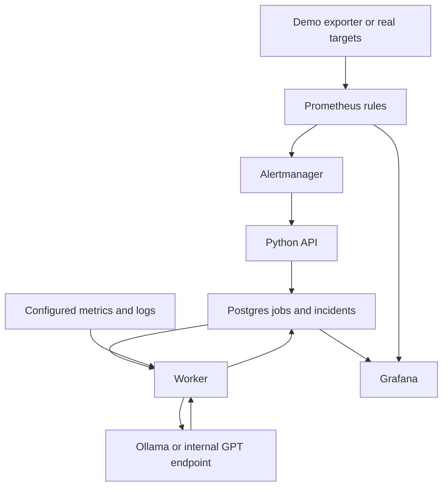

# SignalSift

Repository: https://github.com/stiliajohny/signal-sift


Advisory alert correlation and incident insights.

A Python API and worker that turn Alertmanager notifications into advisory incident briefs and recurring-alert review candidates. Grafana is the interface. Postgres holds alert episodes, investigation jobs, evidence, assessments and feedback.

The default local demonstration uses real Ollama inference with **Qwen3 1.7B**, simulated workload metrics and logs, real Prometheus alert evaluation, and real Alertmanager webhooks. It does not reproduce Kubernetes, run remediation, change alert rules, or suppress existing notifications. Dedicated Kubernetes-event and deployment-history collectors remain extension points.

## Architecture and services

| Compose service | Purpose | Lifetime |
|---|---|---|
| `postgres` | Incident history and durable job queue | Running |
| `api` | Authenticated Alertmanager webhook and incident/feedback APIs | Running |
| `worker` | Fetch evidence, call the configured model, validate and store assessments; scheduled reviews | Running |
| `prometheus` | Scrape the demo exporter and evaluate two demo alert rules | Running |
| `alertmanager` | Group and send firing/resolved notifications to the API | Running |
| `grafana` | Provisioned Postgres/metrics data sources and overview dashboard | Running |
| `simulator` | Controllable workload metrics and sample log endpoints; optional fake model endpoint | Running |
| `ollama` | Local small-model inference with persistent model files | Running; `local-model` profile |
| `configure` | Generate Prometheus/Alertmanager configuration and webhook credential | One-shot |
| `migrate` | Initialise tables, views and read-only Grafana grants | One-shot |
| `model-pull` | Download the model selected by `MODEL_NAME` into Ollama | One-shot; `local-model` profile |



Alertmanager receives **alerts**, not raw metrics. Prometheus scrapes metric samples, evaluates alert expressions, and sends firing/resolved alert objects to Alertmanager. The analysis API accepts Alertmanager's webhook format; it is not a metrics receiver. Your existing alert producer/Alertmanager can replace the demo producer.

The API acknowledges a webhook only after a database transaction commits. A worker claims a leased job, collects bounded evidence, calls the model, validates the JSON response and cited evidence IDs, and commits an assessment. Repeated firing delivery is not counted as another episode. An episode is keyed by labels plus `startsAt`. Original alert severity remains separate from the model's recommended priority.

## Start the local demo

Requirements: Docker Engine or Docker Desktop, Docker Compose v2 with profiles/health-dependent startup, and Python 3.12+ for the small helper scripts. Docker runs Python inside the backend containers. Internet access is needed initially for container images, Python dependencies and the selected Ollama model download.

From this directory:

```bash
python scripts/init_env.py
docker compose config --quiet
docker compose up --build -d
docker compose ps
docker compose logs -f model-pull worker
```

The helper generates separate local credentials in `.env` with mode `0600`. It will not overwrite an existing `.env`. Keep that file private; it is excluded from the archive and Git. Values generated by the helper are URL-safe for the Compose database connection string.

The first start downloads `qwen3:1.7b` (listed at approximately **1.4 GB** when researched on 2026-10-10). That is the model package size, **not** total RAM. Runtime context, model cache, Postgres and Grafana need additional memory. Start with roughly 8 GB available to Docker as a planning estimate and measure on your machine; no hardware latency or memory benchmark has been run here. CPU-only inference is supported and may take minutes. The worker waits for Ollama to have the selected model before claiming jobs; a slow model download does not block webhook ingestion.

Open:

| Interface | Default URL |
|---|---|
| Grafana | http://localhost:3000/d/signal-sift-overview |
| Prometheus | http://localhost:9090 |
| Alertmanager | http://localhost:9093 |
| API demo documentation | http://localhost:8000/docs |
| Simulator scenario | http://localhost:9100/scenario |
| Ollama API | http://localhost:11434 |

Grafana user is `admin`. Its password is the `GRAFANA_ADMIN_PASSWORD` value in `.env`. All published ports bind to localhost. Postgres is not published to the host.

Create a sustained failure:

```bash
curl -X POST http://localhost:9100/scenario/persistent
python scripts/inspect_incidents.py
```

Allow approximately 30 seconds for scraping, the alert's `for: 15s`, evaluation, grouping and webhook delivery, then additional model inference time. Grafana refreshes every 10 seconds. Do not assume a fixed model recommendation: genuine model outputs vary and need human evaluation.

Try the other scenarios:

```bash
curl -X POST http://localhost:9100/scenario/healthy
curl -X POST http://localhost:9100/scenario/transient
curl -X POST http://localhost:9100/scenario/capacity
```

`healthy` resolves the workload condition. `transient` reduces available replicas and automatically recovers after 45 seconds, on the next scrape/query. `capacity` increases desired replicas beyond available replicas and enables a scaling-limit signal. These are exporter fixtures, not actual Kubernetes pods or HPA controllers. Recovery/frequency alone does not establish that an alert was noise.

Inspect authenticated incident details, submit feedback, and read reviews using the API documentation. In the Authorize dialog enter the `API_TOKEN` value alone; Swagger adds the Bearer scheme. Alternatively use an HTTP client that reads the token from a private environment/secret file. `scripts/inspect_incidents.py` lists incidents without exposing the credential in shell history.

Run a review immediately:

```bash
docker compose run --rm worker python -m alert_insight.worker --review
```

Reviews are candidates based on recorded episode counts and feedback, not validated threshold recommendations. There is no historical rule replay or automatic tuning. The normal worker reviews once an hour; `REVIEW_INTERVAL_SECONDS=0` disables it. Use one worker for scheduled review ownership initially.

## What Grafana shows

The dashboard provides open/urgent/pending/failed investigation counts; incident briefs and explanations; original alert severities alongside AI priorities; alert episode spans; episode counts by rule; webhook delivery counts; replica/error charts with incident annotations; and scheduled review candidates. A webhook receipt is not proof someone was paged. `pending`/`unknown` is not evidence of health.

Postgres access is through the `grafana_reader` role, granted `SELECT` only on four reporting views. The metrics data source uses Prometheus's API, including compatible VictoriaMetrics query endpoints. Dashboard provisioning files are in `grafana/provisioning`; dashboard JSON is in `grafana/dashboards`. Edit `scripts/build_dashboard.py` and regenerate it to keep the JSON reproducible:

```bash
python scripts/build_dashboard.py
docker compose restart grafana
```

Metric panels currently use demo metric names. Change their expressions when connecting your own metrics. This repository provisions an overview dashboard, not a custom front-end or an interactive Grafana feedback plugin. Feedback is currently submitted through the API.

## Configure your real sources

Edit `.env` and `config/queries.json`. All query URLs are explicit operator configuration. URLs supplied in alerts are stored as metadata and never fetched. HTTP requests use verified TLS for HTTPS, no automatic redirects, and no implicit environment proxy. Bearer authentication is supported; `NAME_FILE` can replace secret environment variables when the matching file is mounted into the container. Other auth schemes require an approved proxy or a connector extension.

| Setting | Meaning |
|---|---|
| `RUN_MODE` | `demo` labels simulated-input work; `live` disables API docs and labels live assessments |
| `METRICS_BASE_URL` | Prometheus-compatible API base; `/api/v1/query_range` is appended |
| `METRICS_TOKEN` | Optional metrics/rules bearer token |
| `RULES_QUERY_URL` | Full alert-rule API URL, independently configurable for the rule engine |
| `LOGS_BACKEND` | `victorialogs` or `loki` |
| `LOGS_QUERY_URL` | Full LogsQL query URL or full Loki `/loki/api/v1/query_range` URL |
| `LOGS_TOKEN` | Optional log-service bearer token |
| `LOGS_ACCOUNT_ID`, `LOGS_PROJECT_ID` | VictoriaLogs tenant headers |
| `LOGS_TENANT_ID` | Optional Loki `X-Scope-OrgID` header |
| `LABEL_MAP` | JSON map of canonical scope names to incoming alert/metric label names |
| `LOG_FIELD_MAP` | JSON map of canonical scope names to log label/field names |
| `LOG_SCOPE_FIELDS` | Comma-separated scope fields actually present/indexed in your logs |
| `MODEL_API` | `ollama` for native schema output, or `openai` for an internal compatible Chat Completions server |
| `MODEL_CHAT_URL` | Full model HTTP endpoint, not just the server base |
| `MODEL_NAME`, `MODEL_TOKEN` | Served model identifier and optional internal bearer credential |
| `GRAFANA_METRICS_URL` | Metrics base for Grafana's separate data source |
| `PROMETHEUS_SCRAPE_TARGET` | Demo Prometheus target, `host:port`, independent of the analysis query backend |
| `POD_ALERT_EXPR`, `HPA_ALERT_EXPR`, `DEMO_RULE_FOR` | Demo producer rule expressions/duration |
| `ALERTMANAGER_TARGET` | Prometheus's alert delivery target, `host:port` |
| `ANALYSIS_WEBHOOK_URL` | API webhook URL configured in demo Alertmanager |
| `CORRELATION_SECONDS` | Group newly received alerts for the same scope within this window; default 300 |
| `HISTORY_HOURS` | Recorded episode history/review window; default 24 |

For clustered VictoriaMetrics, include its tenant path, for example `https://metrics.internal/select/0/prometheus`. The rule metadata endpoint may instead live on vmalert or Prometheus; set `RULES_QUERY_URL` accordingly. Only `/api/v1/rules`-compatible rule responses are parsed.

VictoriaLogs and Loki are separate adapters. For VictoriaLogs the worker posts a scoped LogsQL query and `extra_filters`; for Loki it sends a LogQL stream selector, nanosecond time bounds and a limit of 50. Set log field mappings to labels actually available in your deployment. Selecting unsupported/missing fields can produce empty results; empty/error/missing evidence is explicit, never treated as healthy.

Example metric templates:

```json
{
  "available_replicas": "my_available_replicas[[selector]]",
  "desired_replicas": "kube_deployment_spec_replicas{namespace=[[value:namespace]],deployment=[[value:workload]]}",
  "error_rate": "rate(my_http_errors_total[[selector:service,environment]][2m])",
  "alert_states": "ALERTS[[alert_selector]]"
}
```

`[[selector]]` uses all populated scope labels. `[[selector:service,environment]]` selects a subset. `[[value:workload]]` inserts a JSON-quoted/escaped value. `[[alert_selector]]` adds `alertstate="firing"`. Required missing scope values fail the individual query instead of causing an unscoped lookup. Keep cluster/environment scoping wherever needed to prevent cross-tenant or cross-cluster ambiguity; the template above illustrates syntax and must be adapted to your labels. Incoming alerts lacking a service identity are isolated and do not trigger broad evidence queries.

If your log source is Loki, the included wire-format simulator can demonstrate that adapter without adding a Loki server:

```dotenv
LOGS_BACKEND=loki
LOGS_QUERY_URL=http://simulator:9100/loki/api/v1/query_range
```

The simulator does not evaluate LogsQL/LogQL; it returns synthetic scoped fixture data. Real VictoriaLogs/Loki compatibility needs validation against your deployment.

Changing `.env` requires container recreation, not just `restart`:

```bash
docker compose up -d --force-recreate configure api worker prometheus alertmanager grafana
```

For rule configuration changes, regenerate with `configure` and restart the producer/Alertmanager. `init_env.py` does not rotate persisted Postgres/Grafana accounts. Changing their environment values alone does not change passwords already stored in persistent volumes; perform deliberate account rotation with the database/Grafana administrator.

## Models and smaller alternatives

The default is `qwen3:1.7b`, listed at about 1.4 GB with Q4_K_M quantisation. This is a compact **candidate** for summarising already-scoped text evidence and classifying advisory priority. It is not proven to detect Kubernetes incidents reliably. The backend does the collection/counting/grouping, so the small model is not expected to discover telemetry on its own.

Research notes and sources are in `MODEL_SELECTION.md`. To compare a newer small model, change `MODEL_NAME` to `qwen3.5:2b-q4_K_M` (listed at about 1.9 GB). Both are smaller than the initially considered Gemma 4 E4B Q4 package at about 6.6 GB. Avoid `latest` and cloud model tags. No benchmark here establishes which is best for your alerts.

After editing `MODEL_NAME`:

```bash
docker compose run --rm model-pull
docker compose up -d --force-recreate worker
```

The selected model files persist in `ollama-data`. Ollama cloud features are disabled with `OLLAMA_NO_CLOUD=1`. Pulling weights still contacts the model registry initially. To operate offline, pre-populate the model/image/dependency caches through your approved distribution process.

The native request sets `format` to the Pydantic JSON schema, `think=false`, temperature zero, `stream=false`, and configured context/output budgets. Pydantic validates the result, and cited evidence IDs must exist. Valid JSON and valid evidence IDs do not guarantee factual correctness. Thinking output is not stored or displayed.

Defaults are `MODEL_CONTEXT_TOKENS=16384`, `MODEL_OUTPUT_TOKENS=2048`, `MODEL_INPUT_CHARS=32000`, `MODEL_TIMEOUT_SECONDS=300`, and `JOB_LEASE_SECONDS=600`. The character cap is a proxy, not exact token accounting; the serving runtime owns its tokenizer. For an approved production tokenizer, add exact preflight token budgeting and verify no serving-side context truncation. Large evidence currently fails rather than silently dropping context. More metric templates increase the evidence request budget; validation requires an adequately long lease.

Optional NVIDIA GPU execution requires a working NVIDIA Container Toolkit:

```bash
docker compose -f compose.yaml -f compose.gpu.yaml up --build -d
```

CPU is the default. No GPU is assumed. Docker GPU configuration and actual inference have not been run in the authoring environment.

For a completely deterministic infrastructure demo without downloading a model, set:

```dotenv
COMPOSE_PROFILES=
MODEL_API=openai
MODEL_CHAT_URL=http://simulator:9100/v1/chat/completions
MODEL_NAME=SIMULATED-fixture
```

Then recreate the worker. If Ollama is already running, stop it explicitly or run Compose with `--remove-orphans`. The fake endpoint never runs an LLM, and its responses are marked `SIMULATED`.

## Connect the approved internal GPT model

When using your approved work model instead of the small local demo model:

```dotenv
RUN_MODE=live
COMPOSE_PROFILES=
MODEL_API=openai
MODEL_CHAT_URL=https://model.internal/v1/chat/completions
MODEL_NAME=gpt-oss-120b
MODEL_TOKEN=
```

Use the actual identifier and auth required by your serving team. No public OpenAI API is used; `openai` here describes a wire protocol. No hosted API key is required. The internal server must return final JSON in `choices[0].message.content`, handle its own approved tokenizer/chat template, and permit the configured generation options. Native Harmony tokens should not be passed directly into this adapter.

Connect your existing Alertmanager by **adding** an analysis webhook receiver/route alongside existing paging routes, preserving existing recipients and grouping/inhibition settings. Its webhook config needs `send_resolved: true` and bearer authorization with the API token. Do not replace your production notification tree with the demo tree. The generated demo receiver only sends to analysis and contains no pager integration.

For an existing external Alertmanager, the API needs a reachable URL. This demo only publishes localhost. Place it behind your existing authenticated TLS ingress/reverse proxy and firewall; do not simply expose every demo port publicly. Sources and model URLs are configuration, not network ACL enforcement.

Plain Postgres is used throughout this version. There is no Kubernetes deployment or CNPG operator. Existing managed Postgres can be connected by adapting the Compose database settings, provisioning `grafana_reader`, running the schema initializer with a migration owner, and granting only the reporting views. The default Compose application database user is a local-demo superuser; separate restricted runtime credentials from the migration owner before a production rollout.

## Operations and implementation limits

- Grouping uses equal canonical service/environment/cluster/namespace/workload scope and a receive-time window. It does not yet use topology, dependency graphs or semantic root-cause correlation.
- Historical occurrence counts start when this service records webhooks. Metrics samples are not episode counts. There is no pre-existing notification-history importer or record of actual pager deliveries/acknowledgements.
- Jobs have leases, claim tokens, up to three attempts and capped backoff. Stale worker results cannot replace a newer incident revision. Failures remain visible. There is no manual retry endpoint yet; a new accepted alert event requeues its incident.
- Metrics evidence is limited to 20 series and 60 evenly sampled points per series; limits/truncation are recorded. Logs are limited to 50 lines, and HTTP responses to 1 MB. Sampling is context, not an exact statistical analysis of all data.
- Schema initialization is idempotent for this initial schema; no versioned upgrade migration framework is included. Start with a new database for this pilot.
- No automatic retention/deletion job, backup orchestration, per-user API RBAC, feedback identity audit, or rate limiter is included. Define these before connecting sensitive production telemetry. See `SECURITY_REVIEW.md` for exact boundaries and mitigations.
- Model assessments are advisory. There is no model tool execution, alert suppression, remediation, auto-configuration change or vector database.

Stop while preserving stored data/model files:

```bash
docker compose down
```

`docker compose down -v` deletes the named data volumes, including incident history and downloaded models; use only when intentionally resetting the demo.

## Repository map and verification

`src/alert_insight`: API, queue/storage, collectors, model adapter, worker, provisioning and simulator. `compose.yaml` and `compose.gpu.yaml`: deployment. `config/queries.json`: evidence queries. `grafana`: provisioned data sources and dashboard. `scripts`: environment generation, safe incident listing and dashboard generation. `requirements.lock`: runtime version pins. `SECURITY_REVIEW.md`: reviewable data flow and limitations. `VALIDATION.md`: checks actually performed.

No new automated test suite was added, following your request. Basic Python/configuration and mocked-flow checks are recorded separately. Docker/real Postgres/Ollama runtime validation must be performed on your Docker host before treating the stack as verified end to end.
